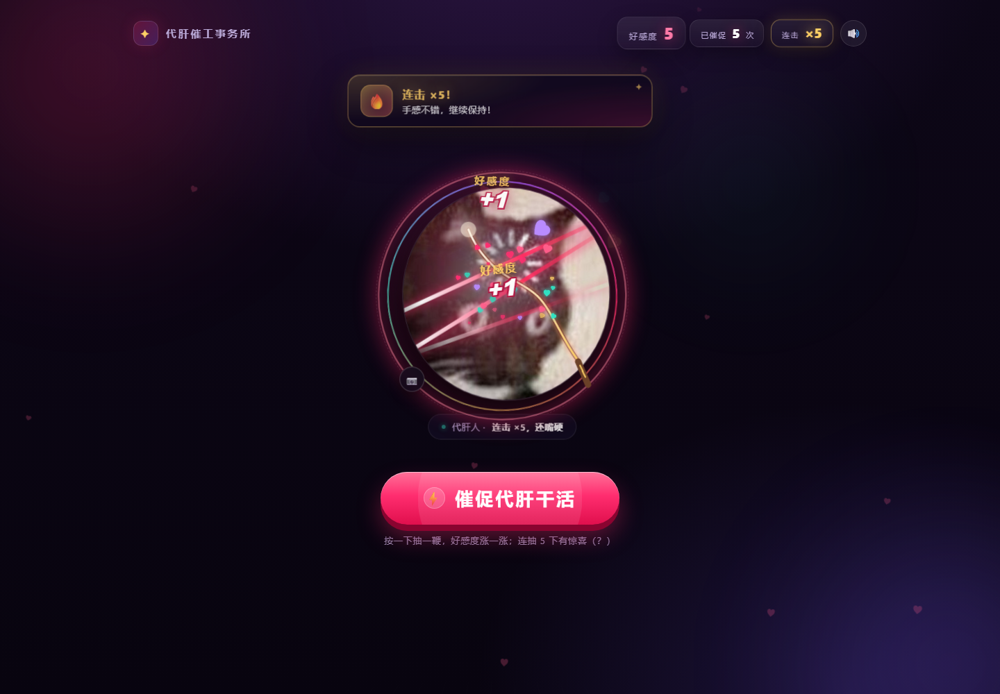

# 代肝催工事务所

一个纯前端的小网站：按一下 **「催促代肝干活」**，头像（圆形裁剪）就会被鞭子抽一下，同时随机弹出 1~5 个 **「好感度 +1」** 飘字；连续抽打会累计连击，到特定数字还会弹出鼓励语。好感度、催促次数和头像会保存在本地。



## 打开方式

直接双击 `index.html` 即可在浏览器里玩（无需服务器、无需联网、无需安装依赖）。

> 想用本地服务器也可以：在项目目录执行 `python -m http.server 8080`，然后访问 `http://localhost:8080`。

## 换头像

三种方式任选：

1. **拖拽**：把图片直接拖进页面（拖到头像上会出现「松手，换上新头像」），会自动居中裁剪成圆形展示。
2. **点击 📷 按钮**：头像左下角的相机按钮，选择本地图片。
3. **直接放文件**：把图片命名为 `avatar.jpg` 或 `avatar.png`，放进 `assets/` 目录，刷新页面即可。

> 当前默认头像是你提供的猫猫图（`assets/avatar.jpg`）。上传的新头像会自动压缩成 512×512 并保存到浏览器本地；换浏览器 / 清缓存后会恢复默认的猫猫头像。

## 玩法说明

- 每按一次按钮：甩鞭 → 命中特效（白光、鞭痕、冲击波、屏幕震动、爱心迸出）→ 随机个数「好感度 +1」→ 好感度按实际飘字个数累加。
- **连击计数**：两次点击间隔小于 1.8 秒就会累计连击（右上角「连击 ×N」），断档 1.8 秒后归零。
- **连击鼓励语**：连击达到 **5 / 10 / 20 / 30 / 50 / 100** 时，顶部会弹出对应的鼓励语，并额外迸出爱心、播放上扬音效；100 之后每 50 连击也会继续鼓励。
- 右上角 🔊 是音效开关（鞭响、+1 音效均由 WebAudio 实时合成，不需要音频文件）。
- 好感度、催促次数、头像、静音状态都存在 `localStorage`。想清零：按 `F12` 打开控制台，执行 `localStorage.clear()` 后刷新。

## 上线到你的域名

目标域名：**heimaojingzhang.xin**（阿里云 DNS），托管平台：**GitHub Pages**。

完整步骤、阿里云解析记录、HTTPS 和域名验证请看 [DEPLOY.md](DEPLOY.md)。网站已经带好 `CNAME`、`robots.txt`、`sitemap.xml` 和分享卡片（OG）标签，按文档操作即可。

## 文件结构

```
whip-site/
├── index.html              页面结构
├── styles.css              样式与全部动画
├── app.js                  交互、随机飘字、连击、音效、头像上传
├── preview.png             效果预览
├── CNAME                   GitHub Pages 自定义域名（heimaojingzhang.xin）
├── robots.txt              允许搜索引擎收录
├── sitemap.xml             站点地图
├── DEPLOY.md               GitHub Pages + 阿里云上线指南
├── assets/
│   ├── avatar.jpg          默认头像（猫猫图）
│   └── placeholder.svg     头像缺失时的兜底占位图
└── README.md
```

## 兼容性

支持 Chrome / Edge / Firefox / Safari 等现代浏览器，适配手机与电脑。开启系统「减少动态效果」时会自动弱化动画。
